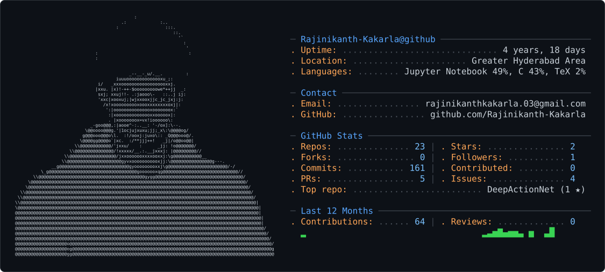

# Rajinikanth K

<picture>
  <source media="(prefers-color-scheme: dark)" srcset="dark_mode.svg" />
  <source media="(prefers-color-scheme: light)" srcset="light_mode.svg" />
  
</picture>

> · Software Builder · AI Explorer

| **[ALPINISM](https://alpinism.onrender.com/)** | **[ChaQ](https://chaqapp.ai.studio/)** | **[Forum](https://forum-app.ai.studio/)** |
|---|---|---|

| **[Porfolio Website](https://rajinikanth-kakarla.netlify.app/)** |
|---|

- Building **production-ready software solutions**
- Exploring **Agentic AI** and intelligent systems
- Working with **Machine Learning** and emerging technologies
- Turning ideas into **real-world products**
- Exploring new technologies and experimenting with what’s next
- Passionate about **building, learning, and solving problems**
- Always curious. Always building.

### Currently Exploring

`Agentic AI` · `Machine Learning` · `Software Engineering` · `Product Development`

